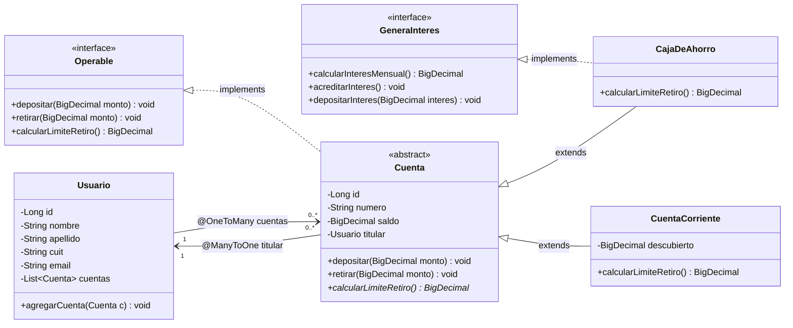
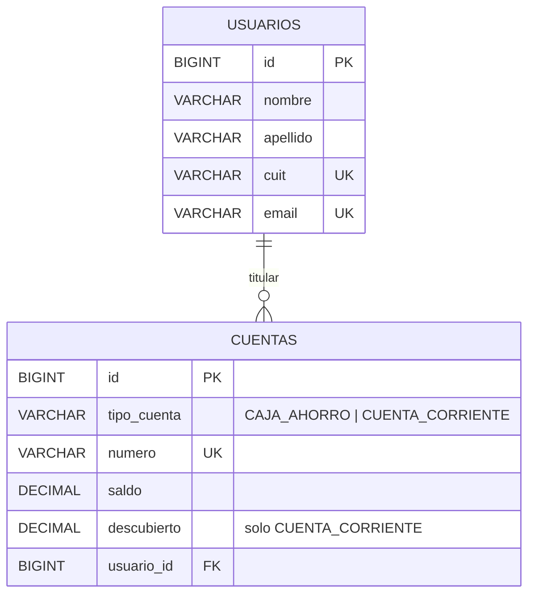

# Modelo de dominio

Un **Usuario** puede tener **varias Cuentas** (`@OneToMany`) y cada Cuenta pertenece a **un único** Usuario, su titular (`@ManyToOne`).
`Cuenta` es **abstracta**: no se instancia directamente, sino a través de `CajaDeAhorro` o `CuentaCorriente` (herencia).
`Cuenta` implementa la interfaz `Operable` (contrato de operaciones) y solo `CajaDeAhorro` implementa `GeneraInteres` (capacidad opcional).

## Diagrama de clases

## Cómo queda en la base (MySQL)

Herencia mapeada con `@Inheritance(strategy = InheritanceType.SINGLE_TABLE)`: todas las cuentas viven en una sola tabla `cuentas` y la columna `tipo_cuenta` indica de qué subclase es cada fila.

| Regla de negocio | Caja de ahorro | Cuenta corriente |
| --- | --- | --- |
| Límite de retiro (`calcularLimiteRetiro()`) | El saldo | Saldo + descubierto |
| Puede quedar en negativo | No | Sí, hasta el descubierto |
